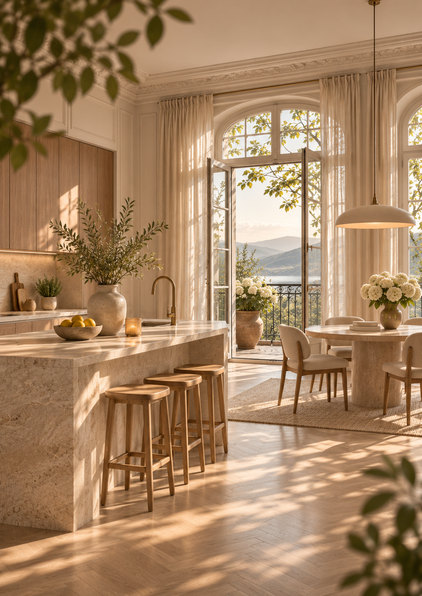
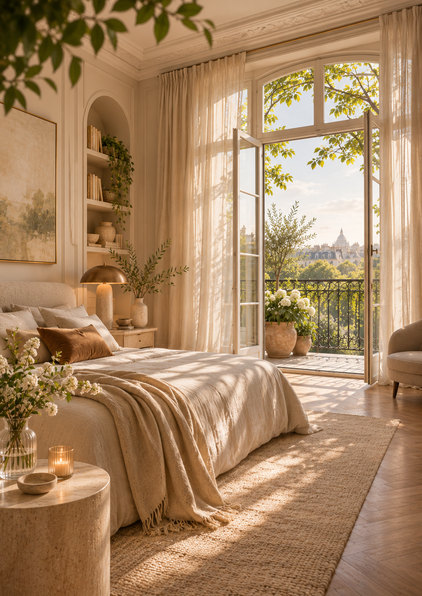
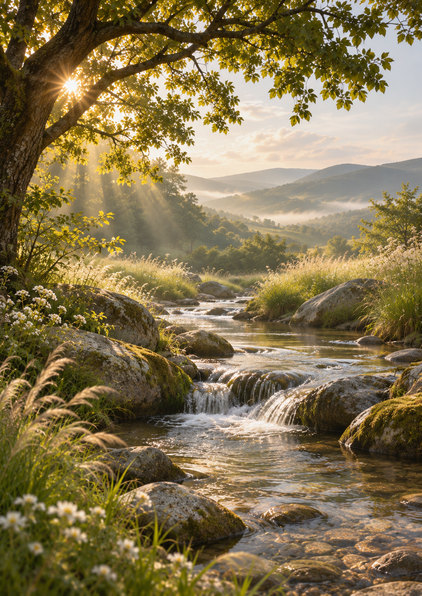

# ASSET-STOCK-01｜独立画像10点の画像目録

> **APP-003 / POÈME / ESTATE** · 2026-11-03 JST · `candidate_unapproved`（本番未採用）

## 最初に見るもの

- [全10点一覧プレビュー（PNG）](../assets/stock/ASSET-STOCK-01/previews/ASSET-STOCK-01_contact-sheet.png)
- [機械可読manifest（JSON）](../assets/stock/ASSET-STOCK-01/manifest.json)
- [検索・並べ替え用CSV](../assets/stock/ASSET-STOCK-01/catalog.csv)
- [原画保存フォルダ](../assets/stock/ASSET-STOCK-01/originals/)

**画像の呼び方**： `APP003-STOCK-0008`、`読書室`、`bookshelf`、`reading` などで特定できる。名前だけで曖昧な場合はIDを優先する。

## 画像一覧

| ID／原画 | 名前 | 主題 | 判別用タグ（主要なもの） |
|---|---|---|---|
| [APP003-STOCK-0001](../assets/stock/ASSET-STOCK-01/originals/APP003-STOCK-0001_urban-curved-residence.png) | 都市の曲面バルコニー住宅 | city exterior | `architecture`, `urban`, `residential`, `exterior`, `facade`, `balcony` |
| [APP003-STOCK-0002](../assets/stock/ASSET-STOCK-01/originals/APP003-STOCK-0002_sunlit-living-room.png) | 木漏れ日のリビング | living room | `interior`, `living`, `sofa`, `balcony`, `window`, `linen` |
| [APP003-STOCK-0003](../assets/stock/ASSET-STOCK-01/originals/APP003-STOCK-0003_lakeside-meadow-path.png) | 湖に続く草の小径 | lake path | `nature`, `lake`, `meadow`, `path`, `water`, `grass` |
| [APP003-STOCK-0004](../assets/stock/ASSET-STOCK-01/originals/APP003-STOCK-0004_garden-courtyard-entrance.png) | 庭園へ続く邸宅エントランス | garden entrance | `architecture`, `entrance`, `courtyard`, `garden`, `stone`, `arch` |
| [APP003-STOCK-0005](../assets/stock/ASSET-STOCK-01/originals/APP003-STOCK-0005_lakeside-glass-villa.png) | 湖畔のガラス邸宅 | waterfront residence | `architecture`, `villa`, `waterfront`, `lake`, `terrace`, `glass` |
| [APP003-STOCK-0006](../assets/stock/ASSET-STOCK-01/originals/APP003-STOCK-0006_sunlit-kitchen-dining.png) | 陽光のキッチンダイニング | kitchen dining | `interior`, `kitchen`, `dining`, `island`, `stone`, `wood` |
| [APP003-STOCK-0007](../assets/stock/ASSET-STOCK-01/originals/APP003-STOCK-0007_morning-bedroom.png) | 朝の寝室と開いた窓 | bedroom | `interior`, `bedroom`, `bed`, `linen`, `balcony`, `window` |
| [APP003-STOCK-0008](../assets/stock/ASSET-STOCK-01/originals/APP003-STOCK-0008_home-library-nook.png) | 書棚と一脚の読書室 | reading corner | `interior`, `reading`, `bookshelf`, `armchair`, `study`, `window` |
| [APP003-STOCK-0009](../assets/stock/ASSET-STOCK-01/originals/APP003-STOCK-0009_coastal-grass-path.png) | 海へ続く崖の小径 | coastal path | `nature`, `sea`, `coast`, `cliff`, `path`, `grass` |
| [APP003-STOCK-0010](../assets/stock/ASSET-STOCK-01/originals/APP003-STOCK-0010_sunlit-woodland-stream.png) | 光の差す渓流 | woodland stream | `nature`, `stream`, `water`, `forest`, `rocks`, `waterfall` |

## 10点を間違えないための説明

### APP003-STOCK-0001｜都市の曲面バルコニー住宅

- **見た目**：緑に囲まれた曲線バルコニーの中層集合住宅。街路から見上げる夕景。
- **検索タグ**：`architecture`, `urban`, `residential`, `exterior`, `facade`, `balcony`, `curved`, `greenery`, `golden_hour`, `street`
- **用途例**：建築を主役にした表紙候補／都市住宅・邸宅イメージ
- **構図・トリミング**：建物は中央〜右を占める。左上には樹冠。文字は画像外の余白に配置する。
- **原画**：[PNG 1055×1491](../assets/stock/ASSET-STOCK-01/originals/APP003-STOCK-0001_urban-curved-residence.png)。SHA-256 `9366790b5120a1d963a5036761c21dba727971478460a9b13882be45afe7bc23`

### APP003-STOCK-0002｜木漏れ日のリビング

- **見た目**：大きな窓とベランダ、ベージュのソファ、石のテーブルを備えた柔らかな居間。
- **検索タグ**：`interior`, `living`, `sofa`, `balcony`, `window`, `linen`, `plant`, `sunlit`, `warm`, `european`
- **用途例**：住まいの生活イメージ／上質な室内空間
- **構図・トリミング**：ソファと窓が主要被写体。全面文字重ねではなく写真区画で扱う。
- **原画**：[PNG 1055×1491](../assets/stock/ASSET-STOCK-01/originals/APP003-STOCK-0002_sunlit-living-room.png)。SHA-256 `c988f67880b15b2d0b0e2210ab853a18668034b080f77f667882deac2c52c088`

### APP003-STOCK-0003｜湖に続く草の小径

- **見た目**：背の高い草花に挟まれた小径が静かな湖と遠景の丘へ続く自然景観。
- **検索タグ**：`nature`, `lake`, `meadow`, `path`, `water`, `grass`, `hills`, `mist`, `golden_hour`, `quiet`
- **用途例**：自然・静寂のイメージ／水辺を主題にした紙面
- **構図・トリミング**：小径が中央下から奥へ伸びる。空・水面を余白候補として使えるが明暗に注意。
- **原画**：[PNG 1055×1491](../assets/stock/ASSET-STOCK-01/originals/APP003-STOCK-0003_lakeside-meadow-path.png)。SHA-256 `b780c9bd87ebaf1171c605fc1cfd4b493a5256645c4384095bb4bc8256b27b16`

### APP003-STOCK-0004｜庭園へ続く邸宅エントランス

- **見た目**：低い石壁と庭の花々、アーチ状ガラス扉をもつ邸宅のエントランス。
- **検索タグ**：`architecture`, `entrance`, `courtyard`, `garden`, `stone`, `arch`, `flowers`, `walkway`, `warm`, `residential`
- **用途例**：エントランス紹介／庭園・植栽と建築の組合せ
- **構図・トリミング**：通路が下から玄関へ視線を導く。玄関は右寄りで写真裁ち落としに注意。
- **原画**：[PNG 1055×1491](../assets/stock/ASSET-STOCK-01/originals/APP003-STOCK-0004_garden-courtyard-entrance.png)。SHA-256 `dd0f723edcf2dbb24f862c3dbe14c0bce65a2c076233b568d1e4b3ac1dfd64b8`

### APP003-STOCK-0005｜湖畔のガラス邸宅

- **見た目**：湖畔に面したテラスと大きなガラス開口部をもつ架空の邸宅。
- **検索タグ**：`architecture`, `villa`, `waterfront`, `lake`, `terrace`, `glass`, `garden`, `greenery`, `morning`, `luxury`
- **用途例**：邸宅・眺望イメージ／建築と自然の共存
- **構図・トリミング**：建物右、湖面左の対比構図。実在の眺望として説明しない。
- **原画**：[PNG 1055×1491](../assets/stock/ASSET-STOCK-01/originals/APP003-STOCK-0005_lakeside-glass-villa.png)。SHA-256 `635e16988138f3c3436fcbe45015612996fb414dd00068dd997c11c712b145d8`

### APP003-STOCK-0006｜陽光のキッチンダイニング

- **見た目**：石材のアイランドキッチンと木製スツール、丸いダイニングテーブルがある空間。
- **検索タグ**：`interior`, `kitchen`, `dining`, `island`, `stone`, `wood`, `windows`, `sunlit`, `warm`, `plants`
- **用途例**：家事・食の生活イメージ／室内設備紹介用の参考
- **構図・トリミング**：石のカウンターが画面左下を占める。人物・製品の実在証拠には使わない。
- **原画**：[PNG 1055×1491](../assets/stock/ASSET-STOCK-01/originals/APP003-STOCK-0006_sunlit-kitchen-dining.png)。SHA-256 `bbbe0f61b33dd6c833522bd51450af569622a774ea54c207914f312f9ee2ddad`

### APP003-STOCK-0007｜朝の寝室と開いた窓

- **見た目**：リネンのベッドと開いたバルコニー窓、朝の光が広がる静かな寝室。
- **検索タグ**：`interior`, `bedroom`, `bed`, `linen`, `balcony`, `window`, `flowers`, `morning`, `calm`, `warm`
- **用途例**：静かな暮らしのイメージ／居室紹介の候補
- **構図・トリミング**：ベッドが左下、明るい窓が中央右。白飛び部分への文字重ねを避ける。
- **原画**：[PNG 1055×1491](../assets/stock/ASSET-STOCK-01/originals/APP003-STOCK-0007_morning-bedroom.png)。SHA-256 `8a253fe5a28fc0f4f98be184c9778f7b14c31c7dc51a1049a96da0f9294abb53`

### APP003-STOCK-0008｜書棚と一脚の読書室

- **見た目**：作り付けの書棚、茶色の椅子、小さな丸机と開放された窓辺の読書空間。
- **検索タグ**：`interior`, `reading`, `bookshelf`, `armchair`, `study`, `window`, `sunlight`, `warm`, `quiet`, `culture`
- **用途例**：読書・文化の生活イメージ／文教・室内表現
- **構図・トリミング**：書棚は右側、窓と椅子が左右に分かれる。背表紙は可読情報として扱わない。
- **原画**：[PNG 1055×1491](../assets/stock/ASSET-STOCK-01/originals/APP003-STOCK-0008_home-library-nook.png)。SHA-256 `ca618dfc5a613697bd6c2ce4dd07838d4401f9bffd1407a93c5facc6fe58a897`

### APP003-STOCK-0009｜海へ続く崖の小径

- **見た目**：背の高い草を抜ける小径、岩場の海岸線と淡い海の水平線。
- **検索タグ**：`nature`, `sea`, `coast`, `cliff`, `path`, `grass`, `horizon`, `golden_hour`, `open`, `quiet`
- **用途例**：海・自然のコンセプト／開放感のイメージ
- **構図・トリミング**：右側の海と空に比較的大きな抜けがある。地理的な実在地点はない。
- **原画**：[PNG 1055×1491](../assets/stock/ASSET-STOCK-01/originals/APP003-STOCK-0009_coastal-grass-path.png)。SHA-256 `e8dd7964075f9f9a0e93a0750ff496d3c3cfb690a33052702ce30b0240e59884`

### APP003-STOCK-0010｜光の差す渓流

- **見た目**：落差の小さい滝と大きな石、木漏れ日と遠景の山並みがある渓流。
- **検索タグ**：`nature`, `stream`, `water`, `forest`, `rocks`, `waterfall`, `sunrays`, `valley`, `greenery`, `serene`
- **用途例**：水辺・自然のコンセプト／静寂・緑のイメージ
- **構図・トリミング**：水流が画面中央を縦に通る。自然のディテールが高密度で文字重ねには不向き。
- **原画**：[PNG 1055×1491](../assets/stock/ASSET-STOCK-01/originals/APP003-STOCK-0010_sunlit-woodland-stream.png)。SHA-256 `0ef012a1f8c8d778be835969aefc724b5d20eb93d96b6bc5d88ea9507cce2251`

## タグ検索の使い方

タグは `tags` 配列内の英小文字とアンダースコアで統一し、複数のタグを**AND条件**として検索できる。日本語名と説明文は人間による確認用。

| 探したい素材 | 検索例 | 想定ID |
|---|---|---|
| 建物の外観 | `architecture` + `exterior` | `APP003-STOCK-0001` |
| 建物と湖 | `architecture` + `lake` | `APP003-STOCK-0005` |
| 読書スペース | `interior` + `bookshelf` | `APP003-STOCK-0008` |
| 水と小径 | `nature` + `lake` | `APP003-STOCK-0003` |
| 海の小径 | `nature` + `sea` | `APP003-STOCK-0009` |
| 流れ・滝 | `nature` + `stream` | `APP003-STOCK-0010` |

機械検索は `manifest.json` の `assets[].assetId / nameJa / scene / category / tags` を使用する。画像のキーワードは**描写の索引用**であり、実際の土地・施設の存在や位置を示すタグではない。

## 印刷適性と採用境界

- **画像形式**：PNG（ラスタ原画）、全10点 1055×1491px、縦横比約0.70758。A4縦（210×297mm、比0.70707）に近い。SVG・文字入り広告レイアウトなし。
- **A4全面**：原画の解像度は約127.5ppi。A4全面に300ppi相当の真正ディテールはないため、全面印刷採用前に要品質確認。幅約89mm以下なら計算上300ppi以上。単なる画素補間は元のディテールを増やさない。
- **制作物の性格**：架空の建物／室内／自然。実際の物件写真・周辺環境の証拠には利用不可。
- **権利・公開**：生成物の個別利用条件やアプリ組込み評価は未審査。`productionApproved=false`、`publishedAllowed=false`。GitHubの素材保存と、GitHub Pagesや広告エンジンから使う本番採用は別工程。
- **対象外の変更**：アプリのHTML/JS、PRINT03本体、公開設定、既存画像の上書きは行わない。

## 検収メモ

最初の代表3点（建築・室内・自然）を基準に、残り7点を生成。写真風の画風は統一しているが、暖色・緑・曲線的な高級感が強く、将来の素材多様化時には異なる時間帯・季節・都市景観の追加を検討する。

**本書は独立素材の目録であり、本番採用の承認書ではない。**
