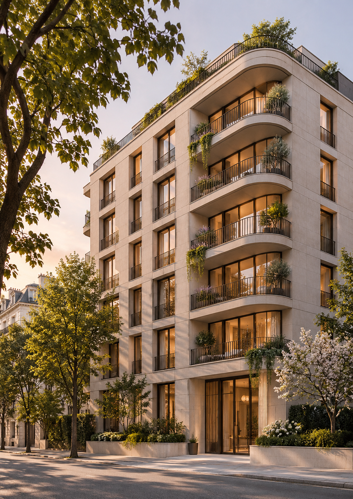
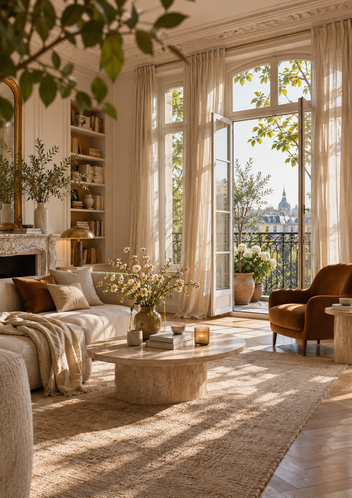
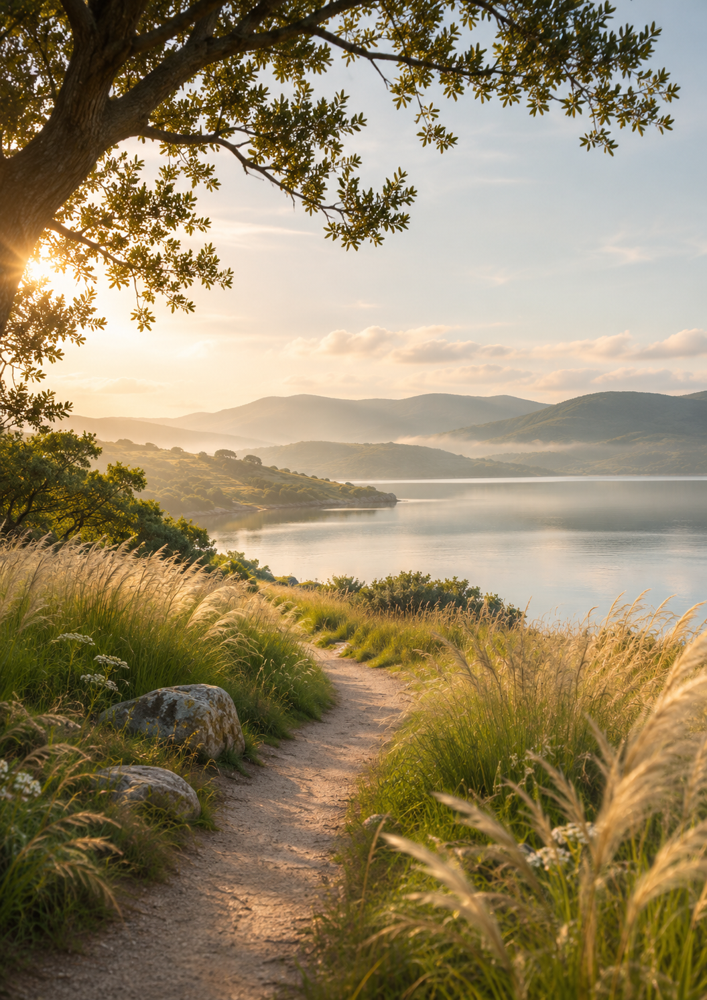
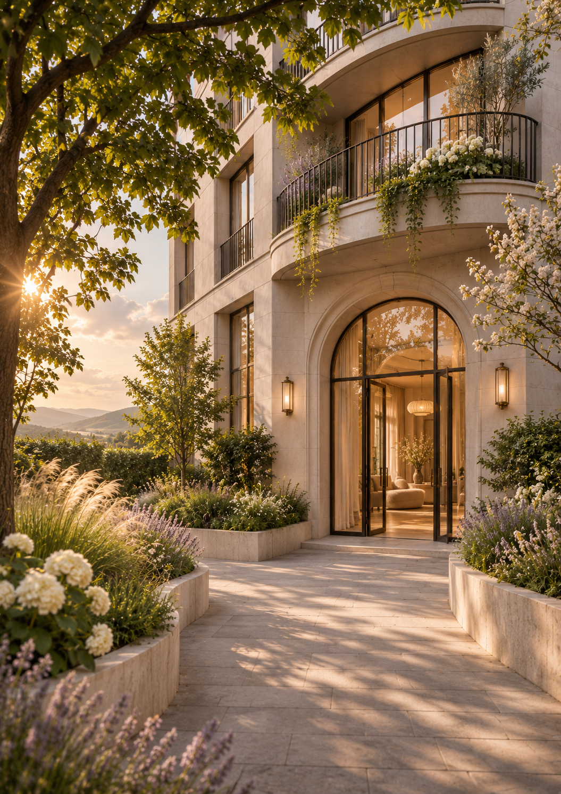
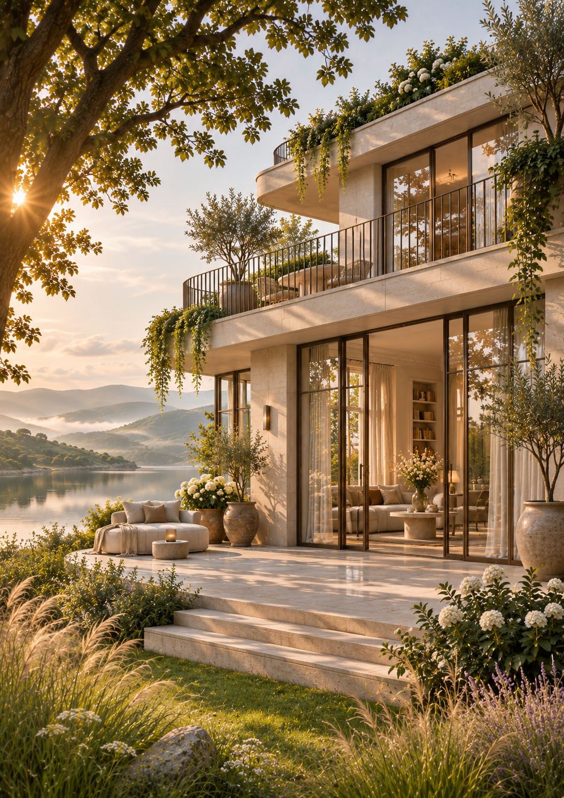
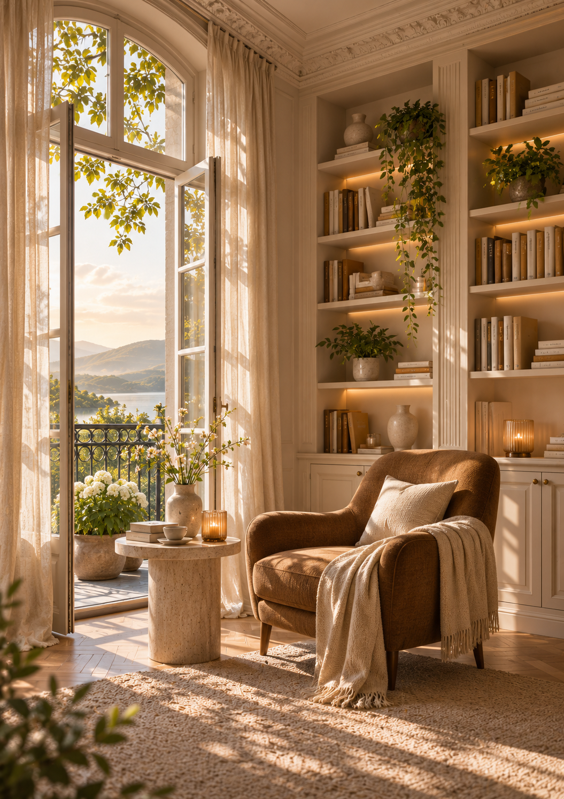
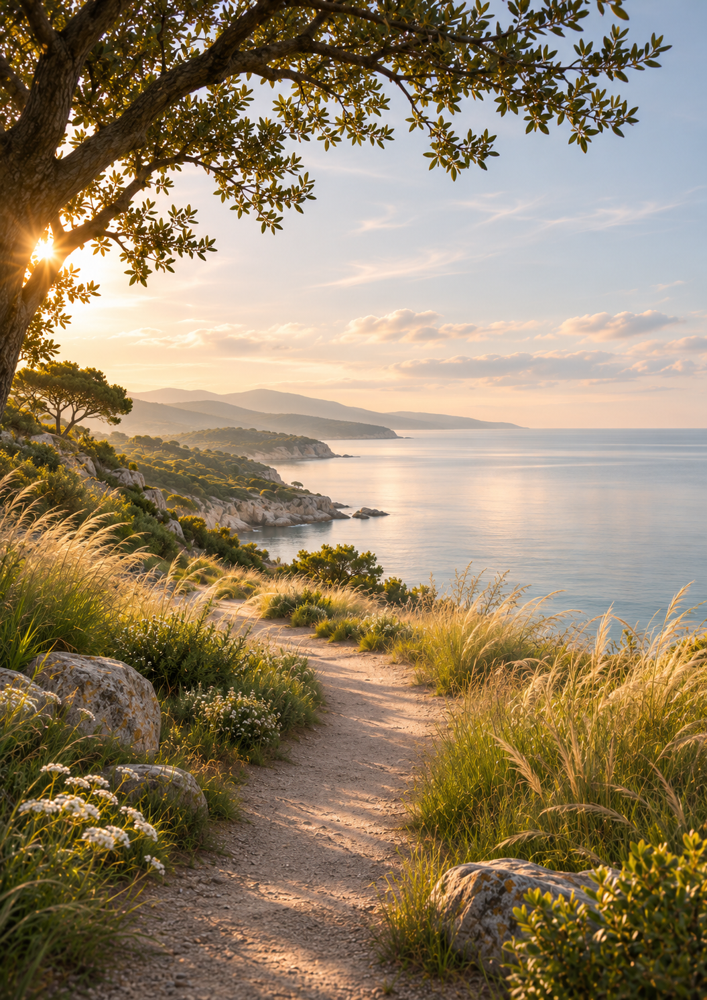
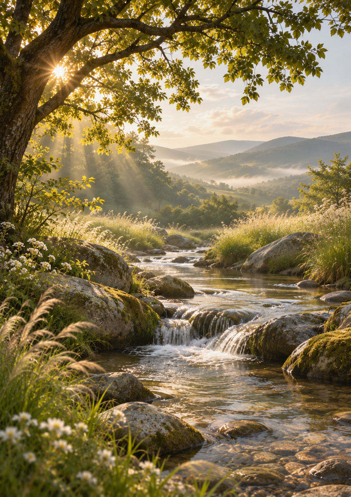

# ASSET-STOCK-01｜独立ラスタ素材10枚の目録

**APP-003 / POÈME / ESTATE** 2026-11-03 JST。全作品は架空の建物・空間・風景をAI生成した独立PNG。画像内には文字・広告レイアウトを含まない。公開リポジトリへの保管と本番採用は別工程。

## 読み出し方

固定 `assetId`（例 `APP003-STOCK-0008`）で一意に指定する。検索語は日本語名、英語タグ（`reading`、`lake`、`exterior` 等）、用途から選べる。詳細は[機械可読manifest](../assets/stock/ASSET-STOCK-01/manifest.json)・[CSV](../assets/stock/ASSET-STOCK-01/catalog.csv)。下の一覧はGitHub上で画像をプレビューするためのもの。

## 全10枚・画像一覧プレビュー

| **0001 都市の曲面バルコニー住宅** |  |
| :--- | :--- |
| `architecture` `urban` `residential` `exterior` `facade` `balcony` | 緑に囲まれた曲線バルコニーの中層集合住宅。街路から見上げる夕景。 |

| **0002 木漏れ日のリビング** |  |
| :--- | :--- |
| `interior` `living` `sofa` `balcony` `window` `linen` | 大きな窓とバルコニー、ベージュのソファ、石のテーブルを備えた柔らかな居間。 |

| **0003 湖に続く草の小径** |  |
| :--- | :--- |
| `nature` `lake` `meadow` `path` `water` `grass` | 背の高い草花に挟まれた小径が静かな湖と遠景の丘へ続く。 |

| **0004 庭園へ続く邸宅エントランス** |  |
| :--- | :--- |
| `architecture` `entrance` `courtyard` `garden` `stone` `arch` | 低い石壁と庭の花々、アーチ状ガラス扉をもつ邸宅の入口。 |

| **0005 湖畔のガラス邸宅** |  |
| :--- | :--- |
| `architecture` `villa` `waterfront` `lake` `terrace` `glass` | 湖畔に面したテラスと大きなガラス開口部をもつ架空の邸宅。 |

| **0006 陽光のキッチンダイニング** |  |
| :--- | :--- |
| `interior` `kitchen` `dining` `island` `stone` `wood` | 石材のアイランドキッチンと木製スツール、丸テーブルの空間。 |

| **0007 朝の寝室と開いた窓** |  |
| :--- | :--- |
| `interior` `bedroom` `bed` `linen` `balcony` `window` | リネンのベッドとバルコニー窓、朝の光の広がる静かな寝室。 |

| **0008 書棚と一脚の読書室** |  |
| :--- | :--- |
| `interior` `reading` `bookshelf` `armchair` `study` `window` | 作り付け書棚、茶色の椅子、小さな丸机と開いた窓の読書空間。 |

| **0009 海へ続く崖の小径** |  |
| :--- | :--- |
| `nature` `sea` `coast` `cliff` `path` `grass` | 背の高い草を抜ける小径、岩場の海岸線と海の水平線。 |

| **0010 光の差す渓流** |  |
| :--- | :--- |
| `nature` `stream` `water` `forest` `rocks` `waterfall` | 小さな滝と大きな石、木漏れ日と山並みのある渓流。 |

## 選定・印刷上の注意

- 共通画素数1055×1491、縦横比はA4に近い。A4全面では約127.5ppi。300ppi品質は保証しない。
- 実際の物件写真・眺望・地理情報として使わない。
- 主題被写体を裁断しないトリミングを優先し、文字や情報は組版時に別レイヤーで追加する。
- `candidate_unapproved` のため一般公開アプリの画像選択肢やPRINT03には未接続。
- GitHubへの保管は権利確認・印刷QA・採用承認を意味しない。

## 各画像の識別・想定用途

### APP003-STOCK-0001｜都市の曲面バルコニー住宅

- **内容**：緑に囲まれた曲線バルコニーの中層集合住宅。街路から見上げる夕景。
- **タグ**：`architecture` `urban` `residential` `exterior` `facade` `balcony` `curved` `greenery` `golden_hour` `street`
- **用途**：建築表紙、都市住宅イメージ
- **構図**：建物中央〜右、左上は樹冠
- **原画**：[PNG](../assets/stock/ASSET-STOCK-01/originals/APP003-STOCK-0001_urban-curved-residence.png)、SHA-256 `9366790b5120a1d963a5036761c21dba727971478460a9b13882be45afe7bc23`

### APP003-STOCK-0002｜木漏れ日のリビング

- **内容**：大きな窓とバルコニー、ベージュのソファ、石のテーブルを備えた柔らかな居間。
- **タグ**：`interior` `living` `sofa` `balcony` `window` `linen` `plant` `sunlit` `warm` `european`
- **用途**：住まいの生活イメージ、居間
- **構図**：ソファと窓が主要被写体
- **原画**：[PNG](../assets/stock/ASSET-STOCK-01/originals/APP003-STOCK-0002_sunlit-living-room.png)、SHA-256 `c988f67880b15b2d0b0e2210ab853a18668034b080f77f667882deac2c52c088`

### APP003-STOCK-0003｜湖に続く草の小径

- **内容**：背の高い草花に挟まれた小径が静かな湖と遠景の丘へ続く。
- **タグ**：`nature` `lake` `meadow` `path` `water` `grass` `hills` `mist` `golden_hour` `quiet`
- **用途**：自然・静寂、水辺の紙面
- **構図**：中央下から奥へ小径
- **原画**：[PNG](../assets/stock/ASSET-STOCK-01/originals/APP003-STOCK-0003_lakeside-meadow-path.png)、SHA-256 `b780c9bd87ebaf1171c605fc1cfd4b493a5256645c4384095bb4bc8256b27b16`

### APP003-STOCK-0004｜庭園へ続く邸宅エントランス

- **内容**：低い石壁と庭の花々、アーチ状ガラス扉をもつ邸宅の入口。
- **タグ**：`architecture` `entrance` `courtyard` `garden` `stone` `arch` `flowers` `walkway` `warm` `residential`
- **用途**：エントランス紹介、植栽と建築
- **構図**：通路が玄関へ視線を導く
- **原画**：[PNG](../assets/stock/ASSET-STOCK-01/originals/APP003-STOCK-0004_garden-courtyard-entrance.png)、SHA-256 `dd0f723edcf2dbb24f862c3dbe14c0bce65a2c076233b568d1e4b3ac1dfd64b8`

### APP003-STOCK-0005｜湖畔のガラス邸宅

- **内容**：湖畔に面したテラスと大きなガラス開口部をもつ架空の邸宅。
- **タグ**：`architecture` `villa` `waterfront` `lake` `terrace` `glass` `garden` `greenery` `morning` `luxury`
- **用途**：邸宅・眺望イメージ、建築と自然
- **構図**：建物右、湖面左の対比
- **原画**：[PNG](../assets/stock/ASSET-STOCK-01/originals/APP003-STOCK-0005_lakeside-glass-villa.png)、SHA-256 `635e16988138f3c3436fcbe45015612996fb414dd00068dd997c11c712b145d8`

### APP003-STOCK-0006｜陽光のキッチンダイニング

- **内容**：石材のアイランドキッチンと木製スツール、丸テーブルの空間。
- **タグ**：`interior` `kitchen` `dining` `island` `stone` `wood` `windows` `sunlit` `warm` `plants`
- **用途**：家事・食の生活イメージ、室内設備
- **構図**：石のカウンターが左下
- **原画**：[PNG](../assets/stock/ASSET-STOCK-01/originals/APP003-STOCK-0006_sunlit-kitchen-dining.png)、SHA-256 `bbbe0f61b33dd6c833522bd51450af569622a774ea54c207914f312f9ee2ddad`

### APP003-STOCK-0007｜朝の寝室と開いた窓

- **内容**：リネンのベッドとバルコニー窓、朝の光の広がる静かな寝室。
- **タグ**：`interior` `bedroom` `bed` `linen` `balcony` `window` `flowers` `morning` `calm` `warm`
- **用途**：静かな暮らし、居室紹介
- **構図**：ベッド左下、明るい窓中央右
- **原画**：[PNG](../assets/stock/ASSET-STOCK-01/originals/APP003-STOCK-0007_morning-bedroom.png)、SHA-256 `8a253fe5a28fc0f4f98be184c9778f7b14c31c7dc51a1049a96da0f9294abb53`

### APP003-STOCK-0008｜書棚と一脚の読書室

- **内容**：作り付け書棚、茶色の椅子、小さな丸机と開いた窓の読書空間。
- **タグ**：`interior` `reading` `bookshelf` `armchair` `study` `window` `sunlight` `warm` `quiet` `culture`
- **用途**：読書・文化、文教・室内表現
- **構図**：書棚右側、窓と椅子が左右に分かれる
- **原画**：[PNG](../assets/stock/ASSET-STOCK-01/originals/APP003-STOCK-0008_home-library-nook.png)、SHA-256 `ca618dfc5a613697bd6c2ce4dd07838d4401f9bffd1407a93c5facc6fe58a897`

### APP003-STOCK-0009｜海へ続く崖の小径

- **内容**：背の高い草を抜ける小径、岩場の海岸線と海の水平線。
- **タグ**：`nature` `sea` `coast` `cliff` `path` `grass` `horizon` `golden_hour` `open` `quiet`
- **用途**：海・自然、開放感
- **構図**：右側の海と空に抜けがある
- **原画**：[PNG](../assets/stock/ASSET-STOCK-01/originals/APP003-STOCK-0009_coastal-grass-path.png)、SHA-256 `e8dd7964075f9f9a0e93a0750ff496d3c3cfb690a33052702ce30b0240e59884`

### APP003-STOCK-0010｜光の差す渓流

- **内容**：小さな滝と大きな石、木漏れ日と山並みのある渓流。
- **タグ**：`nature` `stream` `water` `forest` `rocks` `waterfall` `sunrays` `valley` `greenery` `serene`
- **用途**：水辺・自然、静寂・緑
- **構図**：水流が中央を縦に通る
- **原画**：[PNG](../assets/stock/ASSET-STOCK-01/originals/APP003-STOCK-0010_sunlit-woodland-stream.png)、SHA-256 `0ef012a1f8c8d778be835969aefc724b5d20eb93d96b6bc5d88ea9507cce2251`
